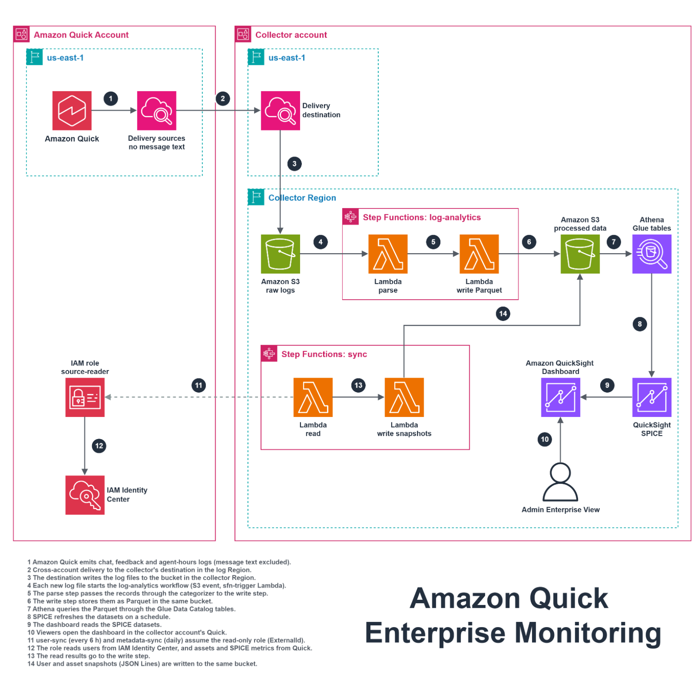
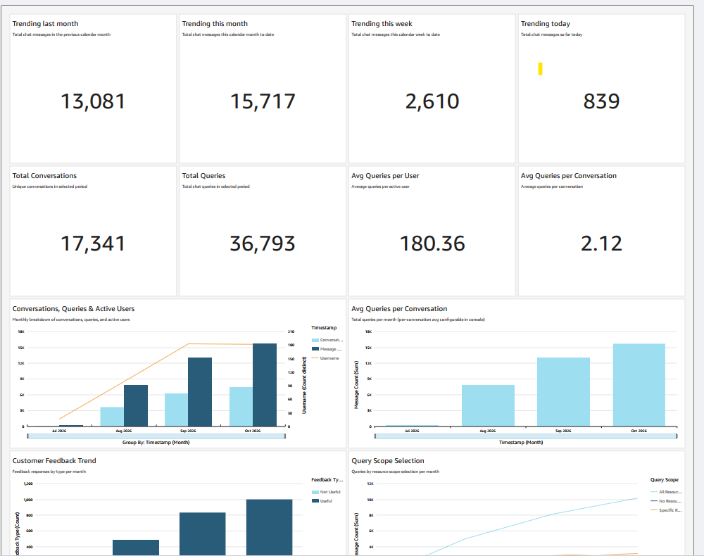
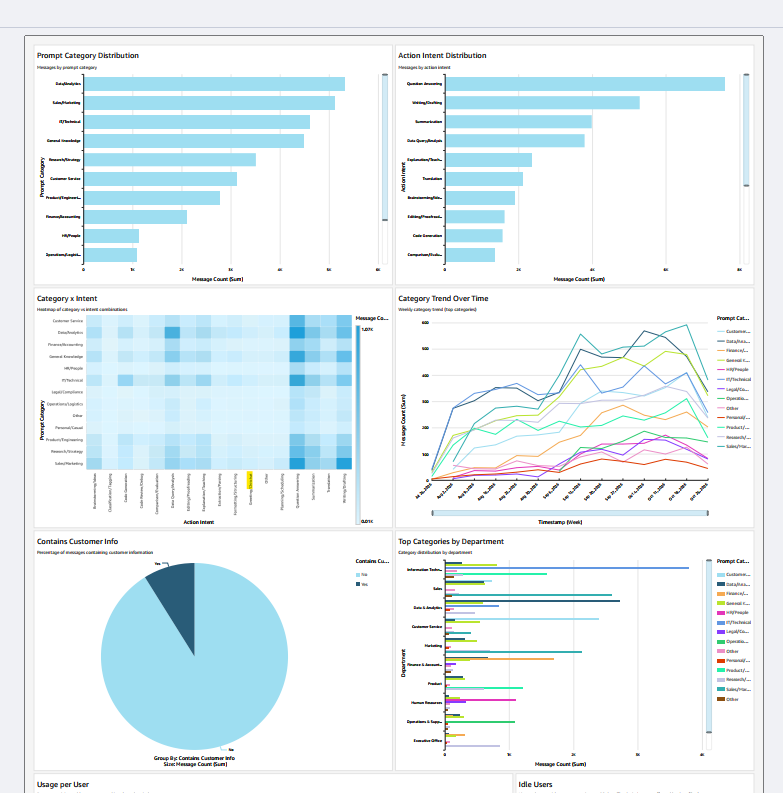
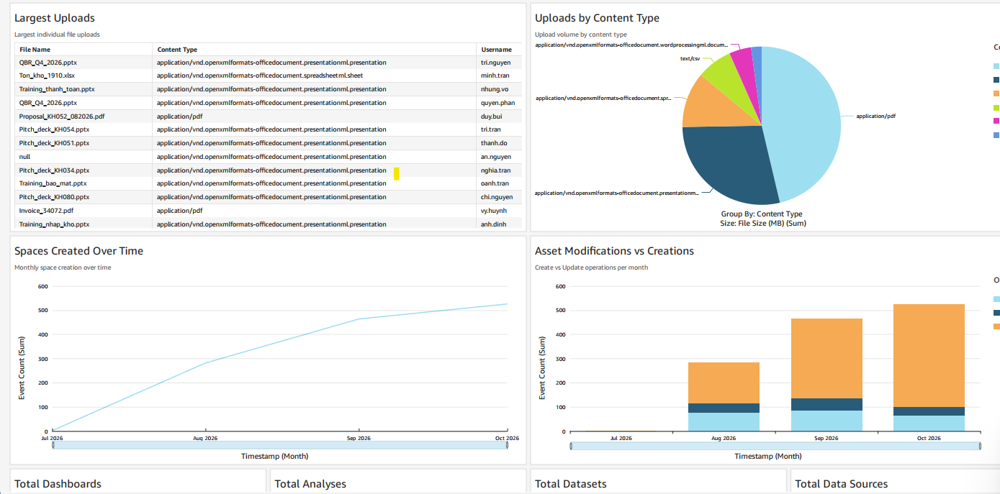
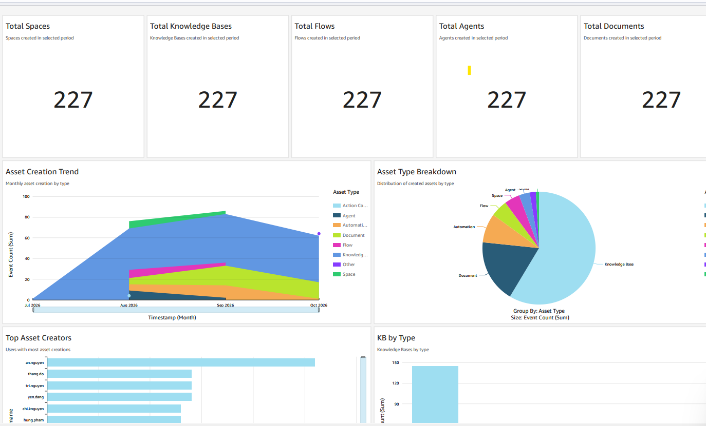

# Enterprise Cross-Account Amazon Quick Monitoring

Terraform to monitor **Amazon Quick** (Quick Suite) usage of one AWS account from another,
for example a partner or central team running the dashboard for a business unit, and to
move the whole monitoring into the monitored account later without losing data.

It extends the single-account sample
[aws-samples/sample-quicksuite-usage-dashboard](https://github.com/aws-samples/sample-quicksuite-usage-dashboard)
(Apache-2.0). The dashboard, datasets and pipeline are the upstream ones; this repository adds
the cross-account parts and the migration path. See [CHANGES.md](CHANGES.md).

> Not an official AWS project and not affiliated with Amazon Web Services.

## Architecture

The numbered arrows are explained under the image. The editable source is
[docs/architecture.drawio](docs/architecture.drawio) (3 pages: temporary, transition, final);
open it in [draw.io](https://app.diagrams.net).

| Part | Where | Module or example |
|---|---|---|
| Delivery sources and deliveries, read-only role | Monitored account | `modules/quicksuite-source-account`, `examples/cross-account/source` |
| Delivery destination in the log Region | Collector account | `modules/quicksuite-log-destination` |
| Bucket, pipeline, Glue, SPICE, dashboard | Collector account | `modules/quicksuite-analytics`, `examples/cross-account/collector` |
| Same instance inside the monitored account | Monitored account | `examples/cross-account/migrate-in` |

Nothing is stored in the monitored account during the cross-account phase. Each monitored
account gets its own collector instance (`name_prefix`), so data from different accounts
never mixes.

## Dashboard preview

Screenshots with sample data.

**Summary:** message trends, conversations, queries per user, feedback and query scope.

**Usage insights:** prompt categories, action intents, trends over time and categories by department.

**Uploads and asset activity:** largest uploads, content types, Spaces created and asset changes over time.

**Asset inventory:** Spaces, knowledge bases, flows, agents, documents and top creators.

## Quick start

Follow [examples/cross-account/README.md](examples/cross-account/README.md). In short:

1. Measure the monitored account: Quick identity Region, the Region where Quick emits its
   logs, existing delivery sources, where IAM Identity Center lives.
2. Apply `examples/cross-account/collector` in the collector account.
3. Apply `examples/cross-account/source` in the monitored account with the collector outputs.
4. Run one FULL_REFRESH on every dataset (the first ingestion races IAM propagation).
5. Use Quick, wait about 20 minutes, check the dashboard.

## Migrating into the monitored account

Each Quick log type allows one delivery source, and one source can feed several deliveries.
The sources created in step 3 therefore stay; migration only adds a delivery to an instance in
the monitored account, runs both side by side, copies history, then removes the cross-account
delivery and role. Steps: [examples/cross-account/README.md](examples/cross-account/README.md#migrating-into-the-customer-account).

## Things we measured

- Quick emitted chat and agent logs in **us-east-1** even when the Quick identity Region was
  another Region. Delivery sources created only in the dashboard Region received nothing.
- A delivery to a CloudWatch Logs destination cannot cross Regions; a delivery to an S3
  destination can.
- Vended logs are not retroactive: the dashboard starts on the day the deliveries are created.
- The first SPICE ingestion after apply can fail with `s3:ListBucket` PERMISSION_DENIED and
  the dashboard then shows "Cannot access data for this visual" until one full refresh succeeds.

## Data and privacy

- Chat deliveries exclude `user_message` and `system_text_message`; feedback excludes
  `feedback_details` unless `include_feedback_text = true`.
- The collector still receives user names, emails and departments from IAM Identity Center
  plus chat metadata. Get the monitored account owner's agreement before deploying.
- `cloudtrail_mode = "disabled"` in the cross-account example: the collector does not read the
  monitored account's API history, so the Asset Inventory tab stays empty.

## Single-account usage

The upstream single-account behaviour is unchanged when the new variables are left at their
defaults. Its guide is kept in [docs/single-account-guide.md](docs/single-account-guide.md).

## License

Apache-2.0, see [LICENSE](LICENSE) and [NOTICE](NOTICE).
